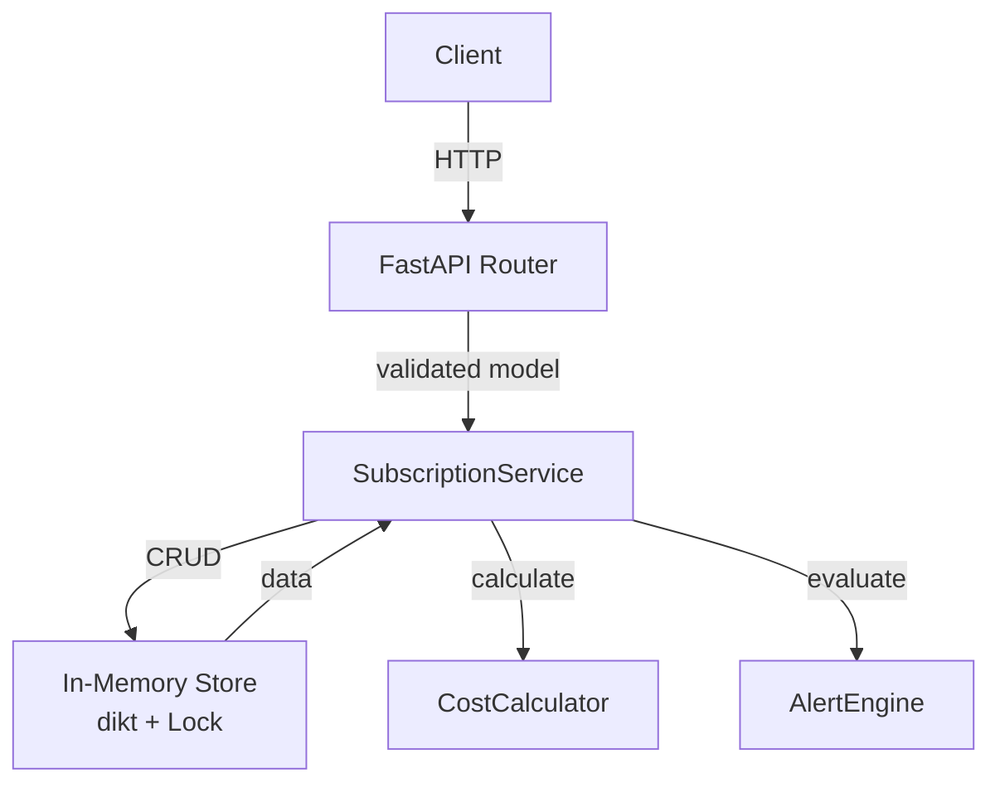

# Design Document — Subscriptions Tracker

## Overview

El Subscriptions Tracker es una API REST construida con **Python + FastAPI** que permite a los usuarios gestionar suscripciones de pago recurrentes. El sistema expone endpoints para crear, listar, actualizar y eliminar suscripciones, así como para calcular el gasto mensual total y generar alertas de renovación próxima.

El almacenamiento es **en memoria** (un diccionario Python protegido por un `threading.Lock`), lo que garantiza que las operaciones de lectura y escritura sean atómicas y thread-safe durante la ejecución de la aplicación, sin necesidad de una base de datos externa.

### Objetivos de diseño

- Validación estricta de entradas mediante modelos Pydantic v2.
- Separación clara de responsabilidades: rutas → servicios → store.
- Lógica de negocio pura y testeable de forma independiente.
- Preparado para reemplazar el store en memoria por una base de datos real con mínimos cambios.

---

## Architecture



La aplicación sigue una arquitectura en capas:

| Capa | Responsabilidad |
|------|----------------|
| **Routers** | Definición de endpoints HTTP, validación de entrada/salida via Pydantic, mapeo de errores a códigos HTTP |
| **Services** | Lógica de negocio: orquestación de CRUD, cálculo de costos, generación de alertas |
| **Store** | Abstracción del almacenamiento en memoria; única fuente de verdad |
| **Models** | Schemas Pydantic para request/response y modelos de dominio |

---

## Components and Interfaces

### 1. `SubscriptionStore`

Almacén en memoria thread-safe. Mantiene un `dict[str, Subscription]` donde la clave es el `subscription_id` (UUID v4 como string).

```python
class SubscriptionStore:
    def __init__(self) -> None: ...

    def add(self, subscription: Subscription) -> Subscription: ...
    def get(self, subscription_id: str) -> Subscription | None: ...
    def list_all(self) -> list[Subscription]: ...
    def update(self, subscription_id: str, data: dict) -> Subscription | None: ...
    def delete(self, subscription_id: str) -> bool: ...
    def is_available(self) -> bool: ...
```

Toda operación de escritura (`add`, `update`, `delete`) se ejecuta bajo `threading.Lock` para garantizar atomicidad (Req 4.3).

### 2. `SubscriptionService`

Servicio de aplicación que encapsula toda la lógica de negocio.

```python
class SubscriptionService:
    def __init__(self, store: SubscriptionStore) -> None: ...

    def create(self, data: SubscriptionCreate) -> Subscription: ...
    def list_all(self) -> list[Subscription]: ...
    def update(self, subscription_id: str, data: SubscriptionUpdate) -> Subscription: ...
    def delete(self, subscription_id: str) -> None: ...
    def get_summary(self) -> SummaryResponse: ...
    def get_alerts(self) -> list[RenewalAlert]: ...
```

### 3. `CostCalculator`

Componente de cálculo puro (sin dependencias externas):

```python
class CostCalculator:
    @staticmethod
    def monthly_cost(subscription: Subscription) -> Decimal:
        if subscription.billing_cycle == BillingCycle.monthly:
            return subscription.cost
        return round(subscription.cost / 12, 2)

    @staticmethod
    def total_monthly_cost(subscriptions: list[Subscription]) -> Decimal:
        active = [s for s in subscriptions if s.is_active]
        total = sum(CostCalculator.monthly_cost(s) for s in active)
        return round(total, 2)
```

### 4. `AlertEngine`

Componente puro de evaluación de alertas:

```python
ALERT_WINDOW: dict[BillingCycle, int] = {
    BillingCycle.monthly: 7,
    BillingCycle.yearly: 30,
}

class AlertEngine:
    @staticmethod
    def days_until_renewal(renewal_date: date, today: date) -> int:
        return (renewal_date - today).days  # floor de días calendario

    @staticmethod
    def evaluate(subscriptions: list[Subscription], today: date) -> list[RenewalAlert]:
        alerts = []
        for sub in subscriptions:
            if not sub.is_active:
                continue
            days = AlertEngine.days_until_renewal(sub.renewal_date, today)
            window = ALERT_WINDOW[sub.billing_cycle]
            if 0 <= days <= window:
                alerts.append(RenewalAlert(...))
        return sorted(alerts, key=lambda a: a.days_until_renewal)
```

### 5. FastAPI Routers

```
POST   /subscriptions                    → crear suscripción
GET    /subscriptions                    → listar suscripciones
PUT    /subscriptions/{subscription_id}  → actualizar suscripción
DELETE /subscriptions/{subscription_id}  → eliminar suscripción
GET    /subscriptions/summary            → resumen de gasto mensual
GET    /subscriptions/alerts             → alertas de renovación
```

> **Nota de orden de rutas**: Las rutas `/subscriptions/summary` y `/subscriptions/alerts` deben estar registradas **antes** de `/subscriptions/{subscription_id}` para evitar que FastAPI interprete `summary` o `alerts` como un `subscription_id`.

---

## Data Models

### Enumeración `BillingCycle`

```python
from enum import Enum

class BillingCycle(str, Enum):
    monthly = "monthly"
    yearly  = "yearly"
```

### Modelo de dominio `Subscription`

```python
from datetime import date
from decimal import Decimal
from uuid import UUID

class Subscription(BaseModel):
    subscription_id: UUID
    name:            str
    cost:            Decimal      # > 0
    billing_cycle:   BillingCycle
    renewal_date:    date          # futura respecto a la fecha de creación/actualización
    is_active:       bool = True
```

### Schema de creación `SubscriptionCreate`

```python
class SubscriptionCreate(BaseModel):
    name:         str
    cost:         Decimal = Field(..., gt=0)
    billing_cycle: BillingCycle
    renewal_date: date
    is_active:    bool = True

    @field_validator("renewal_date")
    @classmethod
    def renewal_date_must_be_future(cls, v: date) -> date:
        if v <= date.today():
            raise ValueError("renewal_date must be a future date")
        return v
```

### Schema de actualización `SubscriptionUpdate`

Todos los campos son opcionales; al menos uno debe estar presente (validado a nivel de servicio).

```python
class SubscriptionUpdate(BaseModel):
    name:          str | None = None
    cost:          Decimal | None = Field(default=None, gt=0)
    billing_cycle: BillingCycle | None = None
    renewal_date:  date | None = None
    is_active:     bool | None = None

    @field_validator("renewal_date")
    @classmethod
    def renewal_date_must_be_future(cls, v: date | None) -> date | None:
        if v is not None and v <= date.today():
            raise ValueError("renewal_date must be a future date")
        return v
```

### Schema de respuesta `SummaryResponse`

```python
class SummaryResponse(BaseModel):
    total_monthly_cost: Decimal  # redondeado a 2 decimales
```

### Schema `RenewalAlert`

```python
class RenewalAlert(BaseModel):
    subscription_id:   UUID
    name:              str
    renewal_date:      date
    billing_cycle:     BillingCycle
    days_until_renewal: int   # floor de días calendario ≥ 0
```

### Estructura de error estándar

Las respuestas de error HTTP 422 siguen el formato por defecto de FastAPI/Pydantic. Para errores de negocio (HTTP 404, 500) se usa:

```python
class ErrorResponse(BaseModel):
    detail: str
```

---


## Correctness Properties

*A property is a characteristic or behavior that should hold true across all valid executions of a system — essentially, a formal statement about what the system should do. Properties serve as the bridge between human-readable specifications and machine-verifiable correctness guarantees.*

Se aplica property-based testing porque el sistema contiene lógica de negocio pura (cálculo de costos, evaluación de alertas, validaciones de entrada, generación de IDs) donde la variación de inputs revela edge cases que los tests unitarios concretos no cubren.

---

### Property 1: Los subscription_id asignados son UUIDs v4 válidos y únicos

*Para cualquier* número N de suscripciones válidas creadas en el sistema, cada `subscription_id` asignado debe ser un UUID v4 válido y no debe existir ninguna colisión entre los N identificadores generados.

**Validates: Requirements 1.2**

---

### Property 2: El campo is_active nunca es sobrescrito por el valor por defecto

*Para cualquier* solicitud de creación de suscripción que incluya explícitamente `is_active` (ya sea `true` o `false`), la suscripción almacenada y retornada SHALL contener exactamente el valor proporcionado, sin ser reemplazado por el valor por defecto `true`.

**Validates: Requirements 1.7**

---

### Property 3: Cualquier valor de cost menor o igual a cero es rechazado con HTTP 422

*Para cualquier* operación de creación o actualización de suscripción en la que el campo `cost` sea menor o igual a 0 (incluyendo valores negativos, cero y fracciones negativas), el sistema SHALL rechazar la solicitud con HTTP 422 sin modificar el estado del store.

**Validates: Requirements 1.5, 3.3**

---

### Property 4: Cualquier valor de billing_cycle distinto de los permitidos es rechazado con HTTP 422

*Para cualquier* operación de creación o actualización en la que el campo `billing_cycle` contenga un valor que no sea exactamente `"monthly"` o `"yearly"`, el sistema SHALL rechazar la solicitud con HTTP 422 sin modificar el estado del store.

**Validates: Requirements 1.6, 3.4**

---

### Property 5: Cualquier renewal_date inválida o no futura es rechazada con HTTP 422

*Para cualquier* operación de creación o actualización en la que el campo `renewal_date` sea (a) un string que no represente una fecha válida en formato ISO 8601 `YYYY-MM-DD`, o (b) una fecha anterior o igual a la fecha actual del servidor, el sistema SHALL rechazar la solicitud con HTTP 422 sin modificar el estado del store.

**Validates: Requirements 1.9, 1.10, 3.6, 3.7**

---

### Property 6: Cada suscripción en la lista contiene exactamente los campos requeridos

*Para cualquier* conjunto de suscripciones almacenadas en el store, la respuesta de `GET /subscriptions` SHALL contener, para cada suscripción, exactamente los campos: `subscription_id`, `name`, `cost`, `billing_cycle`, `renewal_date` e `is_active` — sin campos adicionales ni omitidos — con los valores correspondientes a los datos originalmente creados o actualizados.

**Validates: Requirements 2.3**

---

### Property 7: PUT actualiza únicamente los campos provistos y preserva el resto

*Para cualquier* suscripción existente y cualquier subconjunto no vacío de campos válidos a actualizar (`name`, `cost`, `billing_cycle`, `renewal_date`, `is_active`) con valores válidos, la suscripción resultante SHALL tener exactamente esos campos actualizados con los nuevos valores y todos los demás campos SHALL conservar los valores que tenían antes de la actualización.

**Validates: Requirements 3.1**

---

### Property 8: Una suscripción eliminada no vuelve a aparecer en ningún endpoint posterior

*Para cualquier* suscripción creada y luego eliminada con éxito (`DELETE` → 204), la suscripción eliminada SHALL: (a) no aparecer en la respuesta de `GET /subscriptions`, y (b) no contribuir al `total_monthly_cost` de `GET /subscriptions/summary`. Ambas condiciones deben cumplirse de forma atómica en la misma operación de eliminación.

**Validates: Requirements 4.1, 4.3**

---

### Property 9: El cálculo de gasto mensual total es correcto para cualquier mezcla de suscripciones

*Para cualquier* conjunto de suscripciones almacenadas (con cualquier combinación de `is_active`, `billing_cycle` y `cost`), el campo `total_monthly_cost` retornado por `GET /subscriptions/summary` SHALL ser igual a la suma de: `cost` para cada suscripción activa con `billing_cycle = monthly`, más `round(cost / 12, 2)` para cada suscripción activa con `billing_cycle = yearly`; siendo el resultado final redondeado a 2 decimales. Las suscripciones con `is_active = false` SHALL no contribuir al total.

**Validates: Requirements 5.1, 5.2, 5.4**

---

### Property 10: Las alertas retornadas contienen exactamente las suscripciones activas dentro de la ventana correspondiente

*Para cualquier* conjunto de suscripciones almacenadas, la respuesta de `GET /subscriptions/alerts` SHALL contener exactamente aquellas suscripciones que cumplan simultáneamente: (a) `is_active = true`, y (b) `days_until_renewal` entre 0 y 7 inclusive si `billing_cycle = monthly`, o entre 0 y 30 inclusive si `billing_cycle = yearly`. Las suscripciones con `is_active = false` SHALL ser excluidas independientemente de su `renewal_date`.

**Validates: Requirements 6.1, 6.3, 6.4, 6.7**

---

### Property 11: El campo days_until_renewal en cada alerta es el floor exacto de días calendario

*Para cualquier* `RenewalAlert` generado por el sistema, el campo `days_until_renewal` SHALL ser igual al valor entero resultante del floor de la diferencia en días calendario entre la `renewal_date` y la fecha actual del servidor en el momento de la evaluación.

**Validates: Requirements 6.5**

---

### Property 12: La lista de alertas está ordenada ascendentemente por days_until_renewal

*Para cualquier* conjunto de suscripciones que genere múltiples alertas, la lista retornada por `GET /subscriptions/alerts` SHALL estar ordenada de forma ascendente por `days_until_renewal`, de modo que para cualquier par de alertas consecutivas `a[i]` y `a[i+1]` en la respuesta, se cumpla `a[i].days_until_renewal <= a[i+1].days_until_renewal`.

**Validates: Requirements 6.8**

---

## Error Handling

### Errores de validación (HTTP 422)

FastAPI/Pydantic v2 genera automáticamente respuestas 422 para campos inválidos, ausentes o con valores fuera del dominio permitido. Los validadores personalizados (`field_validator`) en los modelos Pydantic manejan:

- `cost <= 0`: `ValueError("cost must be a positive number greater than 0")`
- `billing_cycle` inválido: manejado por el enum `BillingCycle`
- `renewal_date` con formato inválido: manejado por Pydantic al parsear `date`
- `renewal_date` pasada o igual a hoy: `ValueError("renewal_date must be a future date")`

### Errores de negocio

| Código | Escenario | Manejador |
|--------|-----------|-----------|
| 404 | `subscription_id` no existe en el store | `HTTPException(status_code=404, detail="Subscription not found")` |
| 422 | Body de actualización vacío (ningún campo válido) | Validación en el servicio antes de llamar al store |
| 500 | `SubscriptionStore` no disponible | `try/except` en el servicio, captura `Exception` y relanza como `HTTPException(status_code=500)` |

### Manejo de errores en el store

El `SubscriptionStore.is_available()` devuelve `False` si el diccionario interno no está inicializado. El servicio comprueba disponibilidad antes de cada operación y lanza `HTTPException(status_code=500, detail="Internal server error")` si el store no está disponible.

---

## Testing Strategy

### Enfoque dual

Se combinan **tests unitarios** (ejemplos concretos y edge cases) con **property-based tests** (cobertura universal de inputs) usando [Hypothesis](https://hypothesis.readthedocs.io/en/latest/) como librería PBT para Python.

### Configuración de Hypothesis

```python
from hypothesis import given, settings, HealthCheck
from hypothesis import strategies as st

@settings(max_examples=100, suppress_health_check=[HealthCheck.too_slow])
@given(...)
def test_property_N(...):
    ...
```

Cada property-based test se ejecuta con **mínimo 100 iteraciones** (`max_examples=100`).

### Estrategias de generación (Hypothesis)

```python
# Cost válido
valid_cost = st.decimals(min_value=Decimal("0.01"), max_value=Decimal("9999.99"), places=2)

# Cost inválido
invalid_cost = st.one_of(
    st.decimals(max_value=Decimal("0.00"), places=2),
    st.just(Decimal("0"))
)

# Billing cycle
billing_cycle_strategy = st.sampled_from(["monthly", "yearly"])
invalid_billing_cycle = st.text().filter(lambda s: s not in ("monthly", "yearly"))

# Renewal date futura
future_date = st.dates(min_value=date.today() + timedelta(days=1), max_value=date(2030, 12, 31))

# Renewal date pasada/presente
past_or_today_date = st.dates(max_value=date.today())

# Subscription válida (dict para POST body)
valid_subscription_strategy = st.fixed_dictionaries({
    "name": st.text(min_size=1, max_size=100),
    "cost": valid_cost,
    "billing_cycle": billing_cycle_strategy,
    "renewal_date": future_date.map(lambda d: d.isoformat()),
    "is_active": st.booleans(),
})
```

### Tests unitarios (pytest)

Cubren edge cases específicos no necesariamente capturados por generadores:

- POST sin `name` → 422
- POST sin `cost` → 422
- POST sin `renewal_date` → 422
- GET /subscriptions con store vacío → 200 con `[]`
- GET /subscriptions/summary con todas las suscripciones inactivas → `total_monthly_cost: 0.00`
- DELETE con ID inexistente → 404
- PUT con ID inexistente → 404
- PUT con body vacío → 422
- GET /subscriptions/alerts con ninguna suscripción en ventana → 200 con `[]`
- Store no disponible → 500 (para GET /subscriptions, GET /subscriptions/summary, GET /subscriptions/alerts)

### Property-Based Tests (Hypothesis)

Cada test referencia su propiedad de diseño con el siguiente tag de comentario:
**Feature: subscriptions-tracker, Property {N}: {texto de la propiedad}**

| Test | Propiedad | Tag |
|------|-----------|-----|
| `test_created_ids_are_unique_uuids` | Property 1 | `Feature: subscriptions-tracker, Property 1` |
| `test_is_active_not_overwritten` | Property 2 | `Feature: subscriptions-tracker, Property 2` |
| `test_invalid_cost_rejected` | Property 3 | `Feature: subscriptions-tracker, Property 3` |
| `test_invalid_billing_cycle_rejected` | Property 4 | `Feature: subscriptions-tracker, Property 4` |
| `test_invalid_or_past_renewal_date_rejected` | Property 5 | `Feature: subscriptions-tracker, Property 5` |
| `test_list_response_contains_required_fields` | Property 6 | `Feature: subscriptions-tracker, Property 6` |
| `test_put_updates_only_provided_fields` | Property 7 | `Feature: subscriptions-tracker, Property 7` |
| `test_deleted_subscription_not_visible` | Property 8 | `Feature: subscriptions-tracker, Property 8` |
| `test_summary_monthly_cost_calculation` | Property 9 | `Feature: subscriptions-tracker, Property 9` |
| `test_alerts_contain_correct_subscriptions` | Property 10 | `Feature: subscriptions-tracker, Property 10` |
| `test_days_until_renewal_is_floor` | Property 11 | `Feature: subscriptions-tracker, Property 11` |
| `test_alerts_ordered_by_days_until_renewal` | Property 12 | `Feature: subscriptions-tracker, Property 12` |

### Estructura de archivos de tests

```
tests/
├── unit/
│   ├── test_subscription_store.py
│   ├── test_cost_calculator.py
│   ├── test_alert_engine.py
│   └── test_routes_edge_cases.py
└── property/
    ├── test_creation_properties.py      # Properties 1, 2, 3, 4, 5
    ├── test_list_properties.py           # Property 6
    ├── test_update_properties.py         # Properties 3, 4, 5, 7
    ├── test_delete_properties.py         # Property 8
    ├── test_summary_properties.py        # Property 9
    └── test_alerts_properties.py         # Properties 10, 11, 12
```

### Herramientas

| Herramienta | Propósito |
|-------------|-----------|
| `pytest` | Runner principal |
| `hypothesis` | Property-based testing |
| `httpx` + `TestClient` (FastAPI) | Tests de integración de endpoints |
| `pytest-cov` | Cobertura de código |
